# Monitoring a Maven Application with Prometheus and Grafana on AWS

A hands-on DevOps project that monitors a Java Maven web application (TaskMaster Pro) running on AWS EC2. Two servers are used: one hosts the application and its exporter, the other runs the monitoring stack. Prometheus collects server metrics and uptime probes, and Grafana turns them into live dashboards.

## What this project covers

- **Server monitoring:** CPU, memory, disk, network and uptime of the application server using Node Exporter.
- **Uptime and endpoint monitoring:** HTTP probes against the application and an external URL using Blackbox Exporter (status, HTTP code, response time, DNS, TLS and SSL expiry).
- **Visualization:** Grafana dashboards with auto-refresh, backed by Prometheus as the data source.

## Architecture

```
                         +--------------------------------+
   Browser  ----------->  |  Application Server (EC2)      |
                         |  Maven app (TaskMaster)  :8080  |
                         |  Node Exporter           :9100  |
                         +----------------^---------------+
                                          |  scrape metrics / probe app
                         +----------------+---------------+
                         |  Monitoring Server (EC2)       |
                         |  Prometheus              :9090  |
                         |  Blackbox Exporter       :9115  |
                         |  Grafana                 :3000  |
                         +--------------------------------+
```

| Server | Instance type | Runs | Ports |
|--------|---------------|------|-------|
| Application server | t3.micro | Maven app, Node Exporter | 8080, 9100 |
| Monitoring server | t3.micro | Prometheus, Blackbox Exporter, Grafana | 9090, 9115, 3000 |

Both instances run Ubuntu in `ap-southeast-2` (Sydney).

## Tech stack

- **Cloud:** AWS EC2
- **Application:** Java, Maven
- **Metrics collection:** Prometheus, Node Exporter, Blackbox Exporter
- **Dashboards:** Grafana

## Screenshots

### AWS infrastructure
Two EC2 instances: `monitoring` and `application-server`.

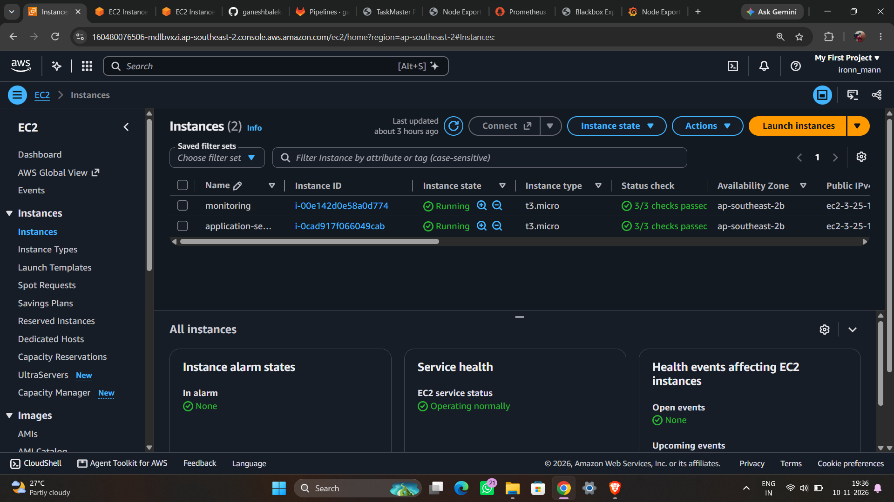

### Application server
Node Exporter installed on the application server.

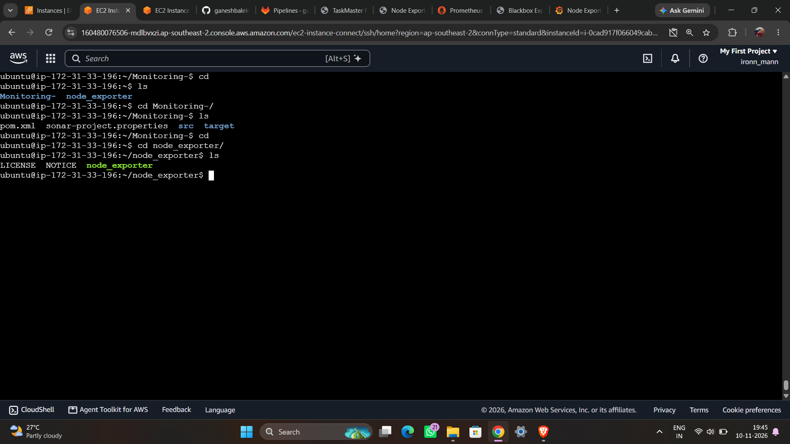

### Monitoring server
Prometheus, Blackbox Exporter and Grafana installed on the monitoring server.

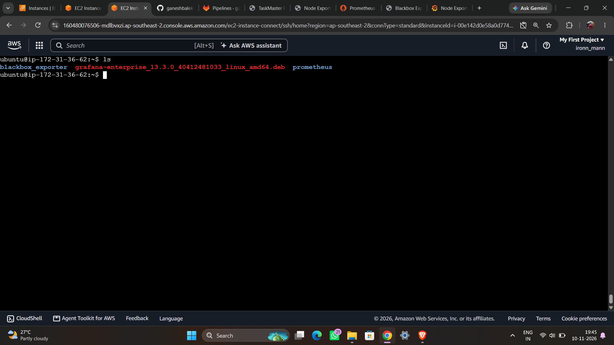

### The monitored application (TaskMaster Pro)

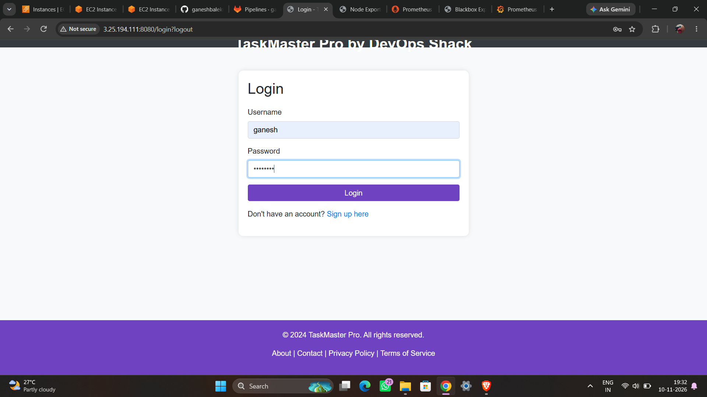

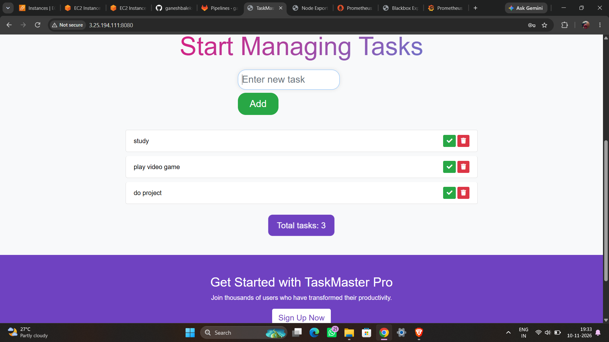

### Exporters

Node Exporter on the application server (port 9100):

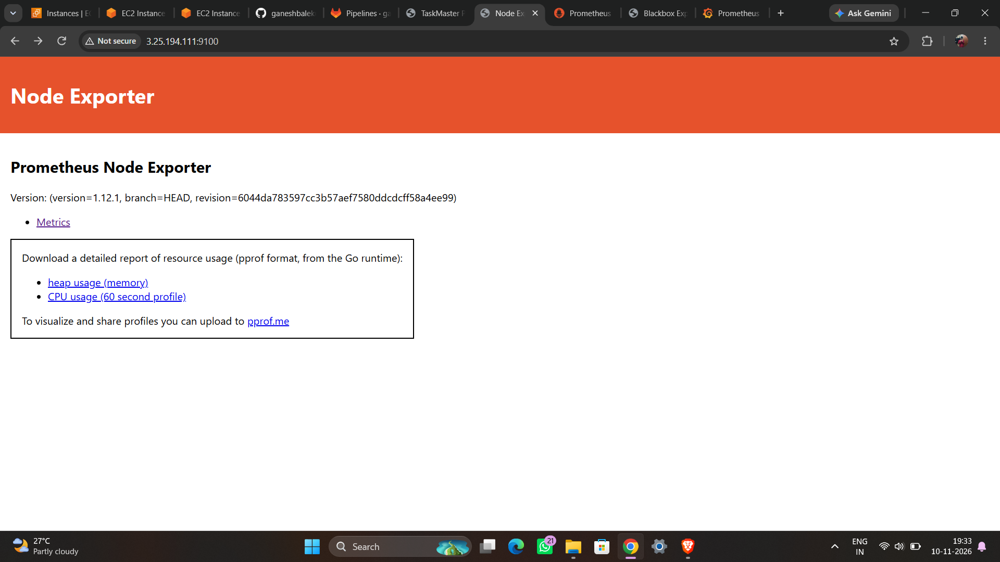

Blackbox Exporter on the monitoring server (port 9115):

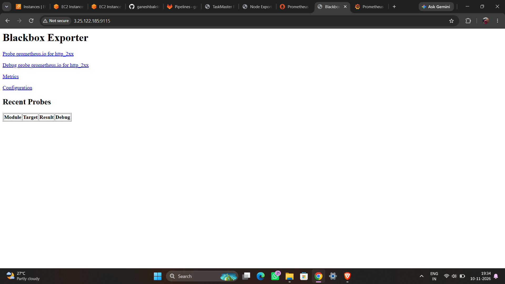

### Prometheus configuration
Scrape jobs for Prometheus itself, Node Exporter and Blackbox Exporter.

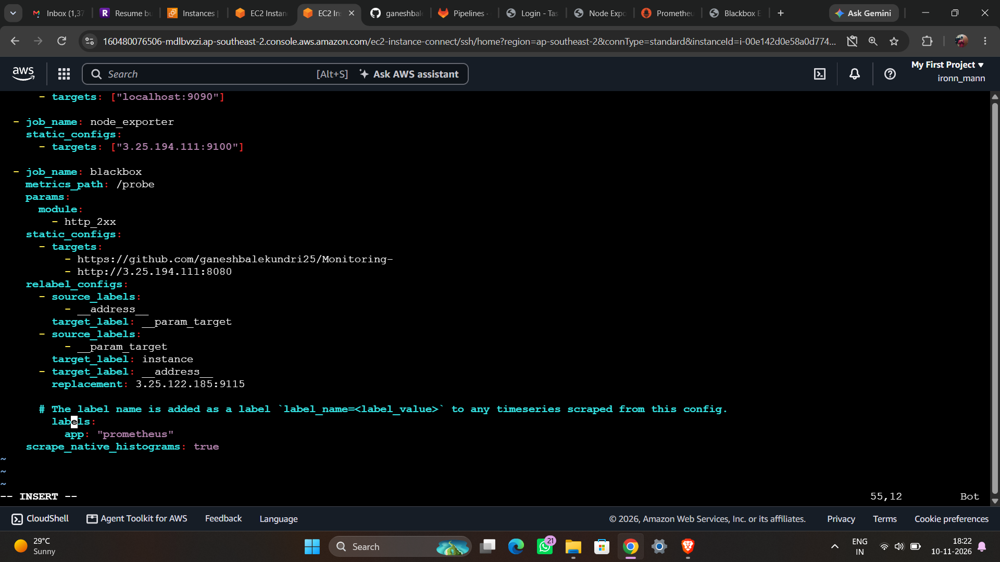

### Prometheus targets
All targets report `UP`.

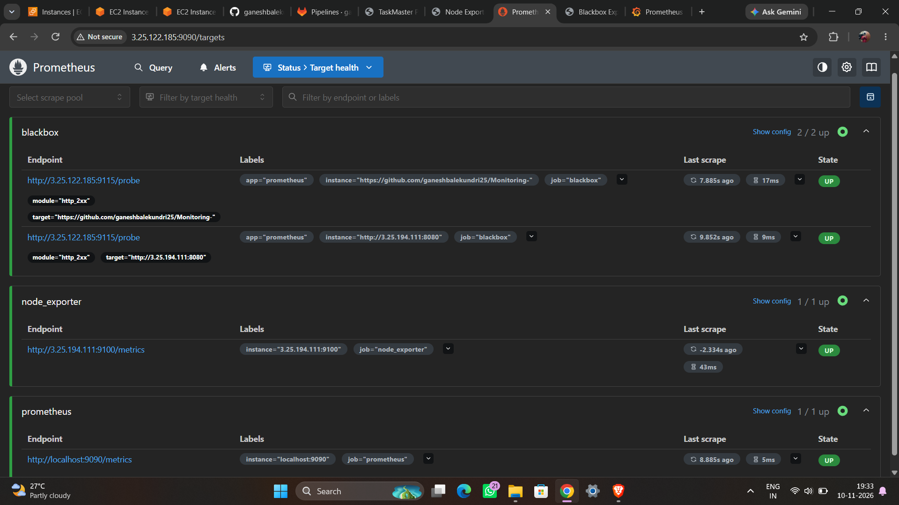

### Grafana: Blackbox Exporter dashboard
Probe status, HTTP status code, HTTP version, SSL and probe duration for each monitored URL.

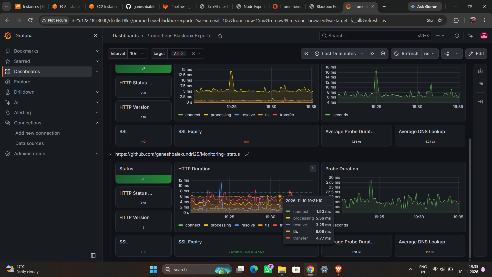

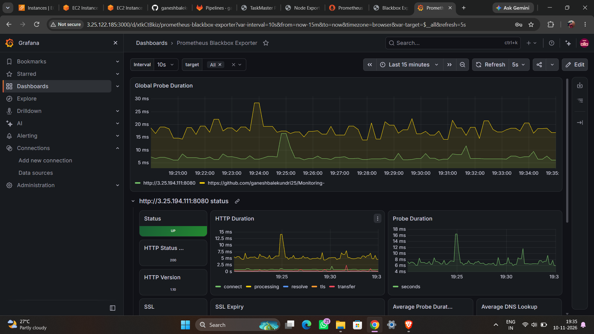

### Grafana: Node Exporter Full dashboard
CPU, memory, disk and network metrics for the application server.

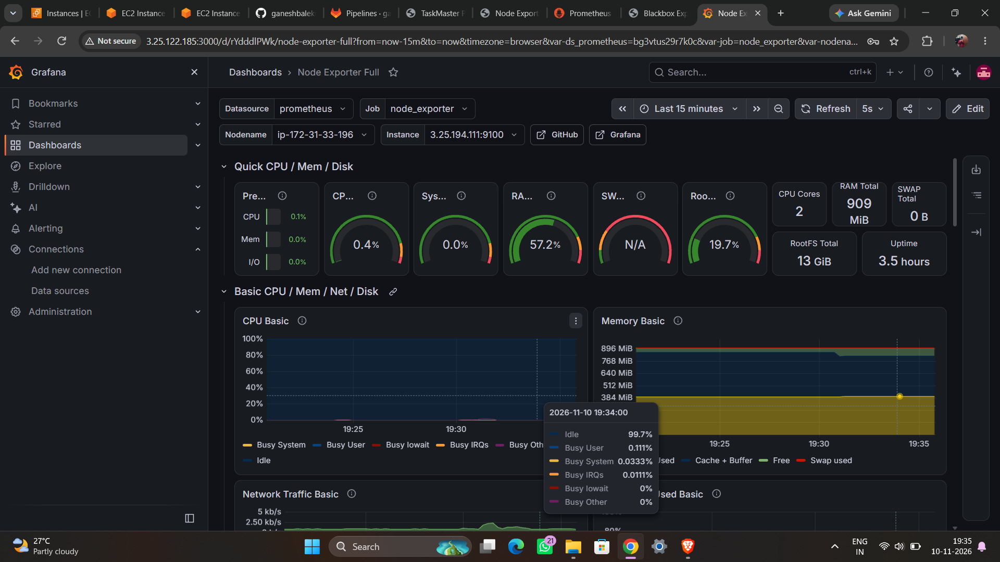

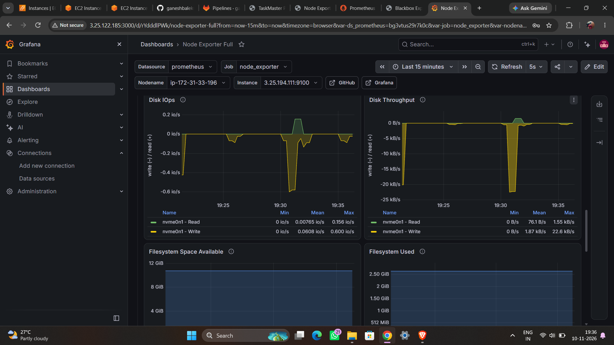

## Setup guide

### 1. Launch two EC2 instances
Create `application-server` and `monitoring` (Ubuntu, t3.micro). Open these inbound ports in the security groups:

| Server | Port | Purpose |
|--------|------|---------|
| Application | 22 | SSH |
| Application | 8080 | Maven application |
| Application | 9100 | Node Exporter (allow only from the monitoring server) |
| Monitoring | 22 | SSH |
| Monitoring | 9090 | Prometheus UI |
| Monitoring | 9115 | Blackbox Exporter |
| Monitoring | 3000 | Grafana UI |

### 2. Application server: build and run the app
```bash
sudo apt update && sudo apt install -y openjdk-17-jdk maven git
git clone https://github.com/ganeshbalekundri25/Monitoring-.git
cd Monitoring-
mvn clean package
java -jar target/<your-jar-name>.jar
```
Replace `<your-jar-name>` with the jar produced in `target/`. The app should open at `http://<application-server-ip>:8080`.

### 3. Application server: install Node Exporter
Download the Linux `amd64` release from the [Node Exporter releases page](https://github.com/prometheus/node_exporter/releases), then:
```bash
tar xvfz node_exporter-*.linux-amd64.tar.gz
cd node_exporter-*.linux-amd64
./node_exporter &
```
Check `http://<application-server-ip>:9100`. For a permanent setup, run it as a systemd service.

### 4. Monitoring server: install Prometheus
Download the Linux `amd64` release from the [Prometheus downloads page](https://prometheus.io/download/), extract it, and edit `prometheus.yml` (see below). Start it with:
```bash
./prometheus --config.file=prometheus.yml &
```

### 5. Monitoring server: install Blackbox Exporter
Download it from the [Blackbox Exporter releases page](https://github.com/prometheus/blackbox_exporter/releases), extract it, and run:
```bash
./blackbox_exporter &
```
It listens on port 9115.

### 6. Monitoring server: install Grafana
```bash
sudo dpkg -i grafana-enterprise_<version>_linux_amd64.deb
sudo systemctl enable --now grafana-server
```
Open `http://<monitoring-server-ip>:3000` (default login `admin` / `admin`, and change the password on first login).

### 7. Configure Prometheus
`prometheus.yml` scrape configuration (replace the IPs with your own):
```yaml
scrape_configs:
  - job_name: prometheus
    static_configs:
      - targets: ["localhost:9090"]

  - job_name: node_exporter
    static_configs:
      - targets: ["<application-server-ip>:9100"]

  - job_name: blackbox
    metrics_path: /probe
    params:
      module: [http_2xx]
    static_configs:
      - targets:
          - https://github.com/ganeshbalekundri25/Monitoring-
          - http://<application-server-ip>:8080
    relabel_configs:
      - source_labels: [__address__]
        target_label: __param_target
      - source_labels: [__param_target]
        target_label: instance
      - target_label: __address__
        replacement: <monitoring-server-ip>:9115
```
The `blackbox` job sends each target to the Blackbox Exporter, which probes it and reports the result back to Prometheus. Restart Prometheus after editing and check `http://<monitoring-server-ip>:9090/targets`.

### 8. Connect Grafana to Prometheus
1. In Grafana go to **Connections, Data sources, Add data source, Prometheus**.
2. Set the URL to `http://localhost:9090` and click **Save & test**.
3. Go to **Dashboards, New, Import** and import these community dashboards by ID:
   - **Node Exporter Full:** `1860`
   - **Prometheus Blackbox Exporter:** `7587`
4. Select the Prometheus data source and click **Import**.

## Key learnings

- How Prometheus pulls metrics from exporters on a schedule.
- The difference between white-box monitoring (Node Exporter) and black-box probing (Blackbox Exporter).
- How `relabel_configs` route probe targets through the Blackbox Exporter.
- Building dashboards for system health and uptime in Grafana.

## Possible improvements

- Add Alertmanager and alert rules (for example when a probe fails or CPU stays high).
- Run exporters as systemd services so they survive reboots.
- Restrict security group rules to known IPs instead of `0.0.0.0/0`.
- Put Grafana behind HTTPS.

## Author

**Ganesh Balekundri** -  (AWS, DevOps)
GitHub: [@ganeshbalekundri25](https://github.com/ganeshbalekundri25)
